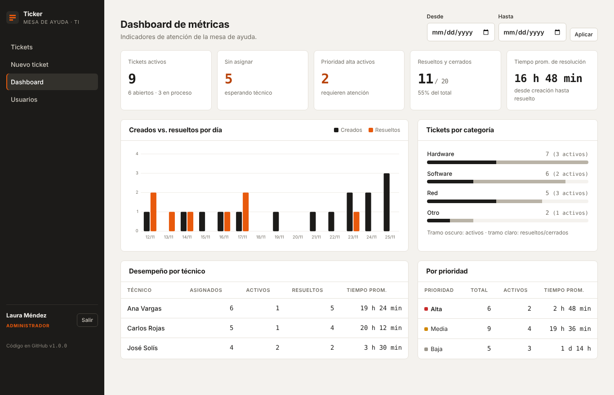
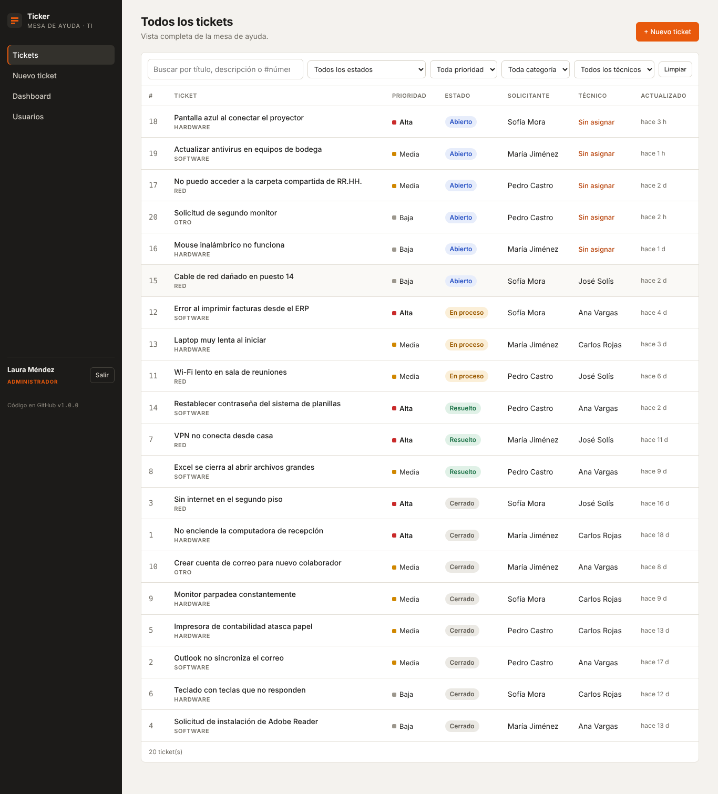
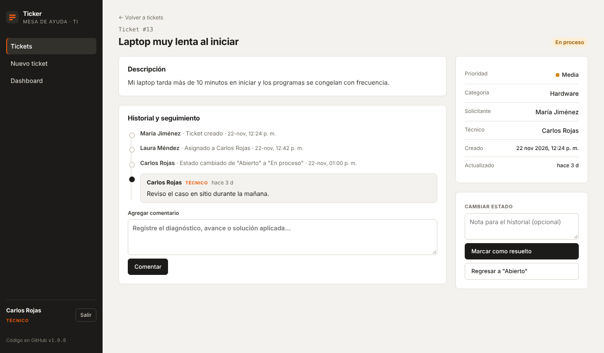
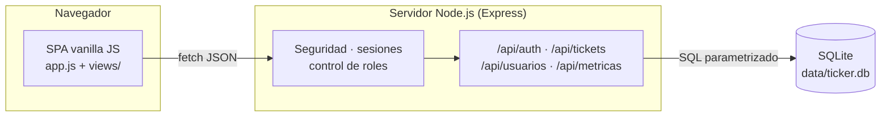
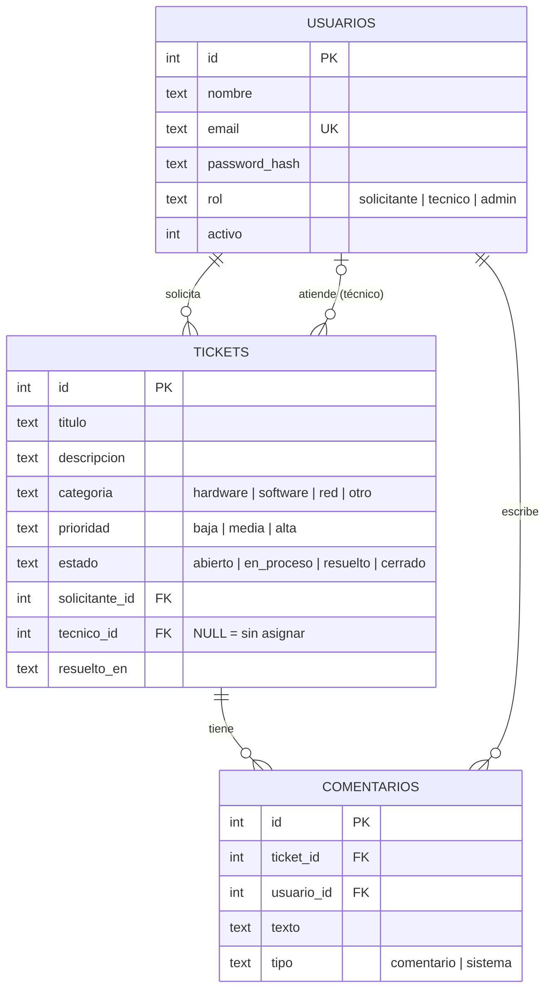
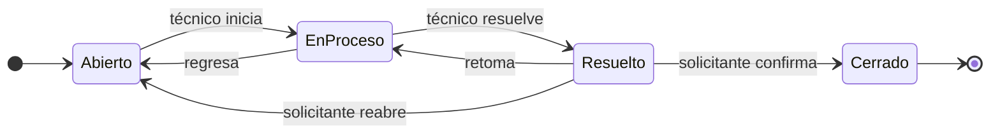

<div align="center">

# Ticker

**Gestión de tickets de soporte técnico para centros de informática**

[](https://github.com/IsaacQuiros14/TickerProject/actions/workflows/ci.yml)


[**Demo en vivo**](https://ticker-or03.onrender.com) · [Instalación](#instalación) · [Manual técnico](docs/Manual_Tecnico.pdf) · [Manual de usuario](docs/Manual_de_Usuario.pdf)



</div>

Ticker es una mesa de ayuda (Help Desk) web: los usuarios reportan incidentes, el administrador los asigna a técnicos y los técnicos registran el seguimiento hasta que el solicitante confirma la solución. Incluye un **dashboard de métricas** como función adicional.

Proyecto final de *Administración y Control de Centros de Informática* — Universidad Internacional San Isidro Labrador, sede Pérez Zeledón.

## Funcionalidades

| Requisito del proyecto | En Ticker |
|---|---|
| Creación de tickets | Título, descripción, categoría (hardware, software, red, otro) y prioridad (baja, media, alta) |
| Asignación | El administrador asigna o reasigna; un técnico puede *tomar* un ticket sin asignar |
| Ciclo de vida | Abierto → En proceso → Resuelto → Cerrado, con reglas de transición por rol |
| Historial | Línea de tiempo con comentarios y eventos automáticos (quién, qué y cuándo) |
| Roles | Solicitante, técnico y administrador, con permisos validados en el servidor |
| Listado con filtros | Por estado, prioridad, categoría, técnico (o sin asignar) y búsqueda por texto o número |
| **Función adicional** | **Dashboard de métricas**: indicadores, tendencia diaria, carga por categoría, prioridad y técnico, tiempo promedio de resolución y filtro por fechas |
| Persistencia real | Base de datos SQLite con llaves foráneas, restricciones y transacciones |

<table>
<tr>
<td></td>
<td></td>
</tr>
<tr>
<td align="center"><sub>Listado con filtros (administrador)</sub></td>
<td align="center"><sub>Detalle, historial y acciones (técnico)</sub></td>
</tr>
</table>

## Stack

| Capa | Tecnología | Por qué |
|---|---|---|
| Servidor | Node.js 22+ · Express 4 | Un solo lenguaje en cliente y servidor; API REST simple y estándar |
| Base de datos | SQLite (`node:sqlite`, incluido en Node) | Motor relacional real en un archivo, sin instalar un servidor de base de datos ni compilar controladores |
| Sesiones | express-session + almacén propio en SQLite | Cookie `HttpOnly`; las sesiones vencidas se limpian solas |
| Contraseñas | bcryptjs | Hash con sal, sin dependencias nativas |
| Frontend | HTML, CSS y JavaScript vanilla (módulos ES) | Sin compilación; gráficos en SVG propio, funciona sin internet |
| Calidad | `node:test` · ESLint · GitHub Actions | 49 pruebas de integración en cada push |

Solo **3 dependencias de producción**.

## Arquitectura



### Modelo de datos



### Ciclo de vida de un ticket



### Permisos

| Acción | Solicitante | Técnico | Administrador |
|---|:---:|:---:|:---:|
| Crear ticket | ✓ | ✓ | ✓ |
| Ver tickets | propios | asignados y sin asignar | todos |
| Comentar | propios | los que ve | todos |
| Tomar ticket sin asignar | | ✓ | |
| Asignar / reasignar | | | ✓ |
| Cambiar estado | confirmar o reabrir | avanzar los suyos | cualquiera |
| Dashboard | | ✓ | ✓ |
| Gestionar usuarios | | | ✓ |

## Instalación

Requisitos: **Node.js 22.13 o superior** (`node -v`).

```bash
git clone https://github.com/IsaacQuiros14/TickerProject.git
cd TickerProject
npm install
npm start
```

Abrir <http://localhost:3000>. La primera vez se crea `data/ticker.db` con 7 usuarios y 20 tickets de ejemplo.

| Comando | Uso |
|---|---|
| `npm start` | Inicia el servidor |
| `npm run dev` | Reinicia el servidor al guardar cambios |
| `npm run seed` | Borra los datos y vuelve a cargar los de demostración |
| `npm test` | Ejecuta las 49 pruebas de integración (base en memoria) |
| `npm run lint` | Revisa el código con ESLint |

### Usuarios de demostración

| Rol | Correo | Contraseña |
|---|---|---|
| Administrador | `admin@ticker.cr` | `admin123` |
| Técnico | `carlos@ticker.cr` | `tecnico123` |
| Solicitante | `maria@empresa.com` | `usuario123` |

La pantalla de inicio de sesión tiene botones para entrar con cada rol en un clic.

### Variables de entorno

| Variable | Por defecto | Descripción |
|---|---|---|
| `PORT` | `3000` | Puerto HTTP |
| `NODE_ENV` | — | `production` activa cookies `Secure`, HSTS y `trust proxy` |
| `SESSION_SECRET` | aleatoria | Clave para firmar la cookie de sesión |
| `DB_PATH` | `data/ticker.db` | Archivo de la base de datos |
| `DEMO_MODE` | `false` | `true` protege las cuentas de demostración (despliegue público) |

## Demo en vivo

**URL:** <https://ticker-or03.onrender.com>

Ticker se despliega gratis en [Render](https://render.com) con el blueprint [`render.yaml`](render.yaml):

1. En Render: **New → Blueprint** y seleccionar este repositorio.
2. Render instala, genera `SESSION_SECRET` y publica la app. Cada push a `main` vuelve a desplegar.

> **Plan gratuito:** el servicio se suspende tras 15 minutos sin uso y tarda cerca de un minuto en despertar. El sistema de archivos es efímero, así que la base se recrea con los datos de ejemplo en cada reinicio. En la demo pública las cuentas de demostración están protegidas contra cambios.

## Calidad y flujo de trabajo

- **CI** ([`.github/workflows/ci.yml`](.github/workflows/ci.yml)): en cada push y pull request corre ESLint, las pruebas en Node 22 y 24, y un *smoke test* que arranca el servidor en modo producción y verifica el health check, el frontend y el login.
- **Pruebas** ([`tests/`](tests)): flujo completo de un ticket, permisos por rol, filtros, gestión de usuarios, métricas y medidas de seguridad, contra una base SQLite en memoria.
- **Dependabot** revisa mensualmente dependencias y acciones.
- **Commits** con [Conventional Commits](https://www.conventionalcommits.org/es/v1.0.0/) (`feat:`, `fix:`, `test:`, `ci:`, `docs:`…).

## Seguridad

- Contraseñas con bcrypt; mismo mensaje y tiempo de respuesta si el correo no existe.
- Límite de 10 intentos de login por IP cada 15 minutos.
- Autorización en el servidor en cada ruta; el usuario se revalida en cada petición, así que desactivar a alguien o cambiarle el rol aplica de inmediato.
- Consultas SQL siempre parametrizadas; todo texto de usuario se escapa antes de mostrarse (XSS).
- Cabeceras: Content-Security-Policy, `X-Frame-Options`, `nosniff`, `Referrer-Policy` y HSTS en producción.
- Cookie de sesión `HttpOnly`, `SameSite=Lax` y `Secure` en producción; la sesión se regenera al iniciar sesión.
- Errores internos con mensaje genérico al cliente y detalle solo en el log.

## Estructura

```
├── server.js            Arranque: datos iniciales y servidor HTTP
├── app.js               Aplicación Express (middleware, rutas, errores)
├── config.js            Variables de entorno
├── db.js                Esquema SQLite y transacciones
├── seed.js              Datos de demostración
├── middleware/          auth (roles) · seguridad (cabeceras, rate limit) · sesiones (store SQLite)
├── routes/              auth · tickets · usuarios · metricas
├── public/              Frontend: index.html, css/, js/app.js, js/views/
├── tests/               Pruebas de integración (node:test)
├── docs/                Manual técnico, manual de usuario y capturas
├── render.yaml          Despliegue en Render
└── .github/             CI, Dependabot y plantilla de PR
```

## Equipo

| Integrante | Rol en el proyecto |
|---|---|
| Isaac Quiros | Desarrollo |
| _[Integrante 2]_ | _[Rol]_ |
| _[Integrante 3]_ | _[Rol]_ |

Licencia [MIT](LICENSE).
